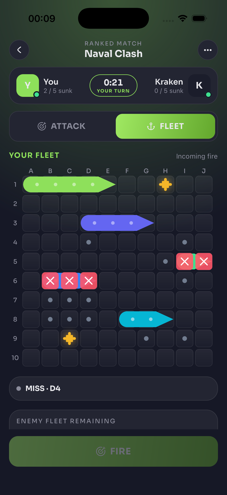
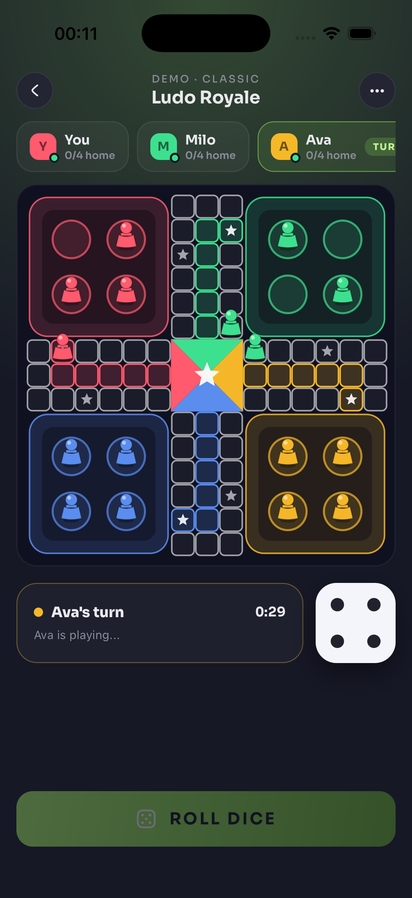
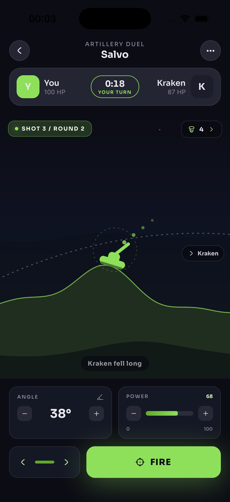
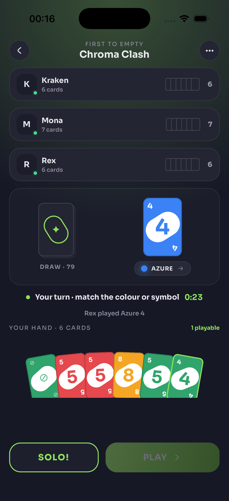
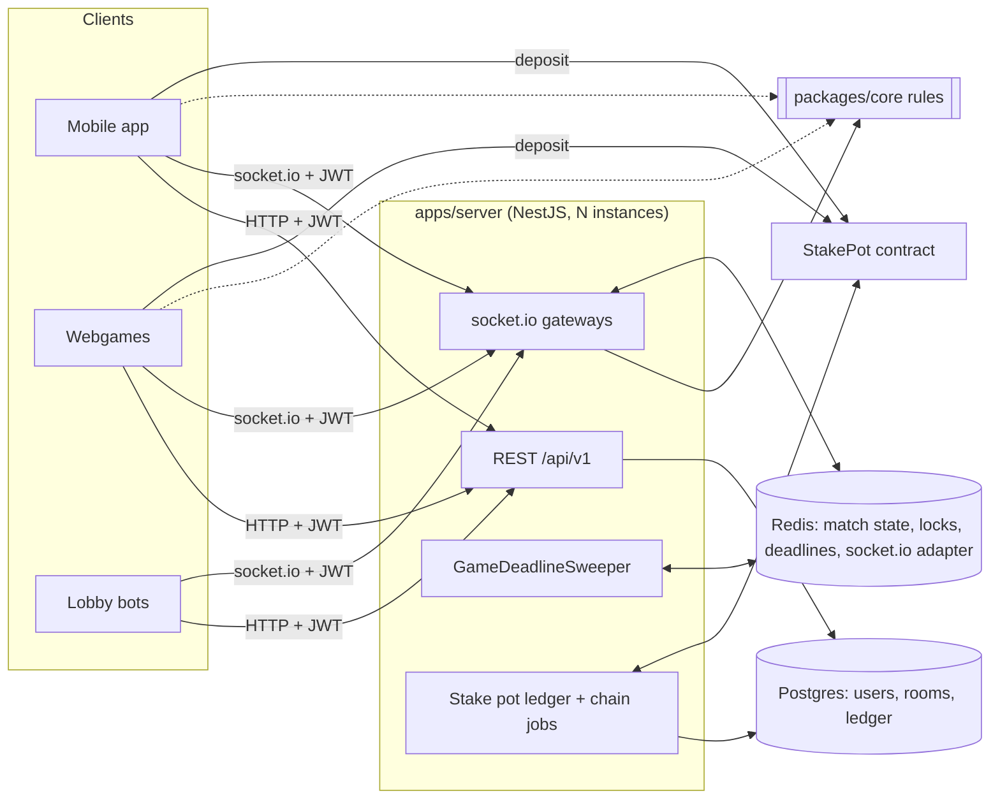

<p align="center">
  
</p>

# Kombat

Kombat is a set of realtime multiplayer mini-games for mobile and web, played
against other people or bots, either for free or for a stake. Players deposit
once into an on-chain custody contract (`StakePot`). From then on every staked
match locks, settles and pays out in an off-chain ledger, so a match needs no
transaction and no signature. The server is authoritative: clients send
intent, the server applies rules that live in a shared TypeScript package, and
every client renders the same state.

<p align="center">
  
  
  
  
</p>

## Games

| Game | Players | What makes it different |
| --- | --- | --- |
| Battleships | 2 | Classic 10x10 fleet battle with hidden mines (hitting one blasts a 3x3 area of your own board) and torpedo/bomb power-ups paid for with points earned by landing hits. |
| Ludo Royale | 2 to 4 | Ludo with a charge meter that fills from rolls, captures and star squares, spent on abilities (launcher, jump, teleport, shield). Players who forfeit or time out three times are eliminated until one stands. |
| Salvo | 2 | Turn-based artillery on procedurally generated, destructible terrain with wind. The server simulates every trajectory and the client replays it. |
| Chroma Clash | 2 to 4 | A colour-matching shedding card game (skip, reverse, draw two, wild colour change, draw four). |
| Triple Cut | 2 | Rock, paper, scissors, best of five, with moves committed simultaneously and revealed together. |

All of them share one turn clock (30 seconds by default, 20 for Salvo, three
timeouts and you lose or are eliminated), so an abandoned match always
resolves without help from either client.

## Repository layout

npm workspaces, orchestrated with Turborepo.

| Path | Role |
| --- | --- |
| [`packages/core`](packages/core) | Platform-agnostic shared code: game rules and bot policies, socket protocol types, the turn clock, stake and token helpers, the typed REST client. Used by every app. |
| [`apps/server`](apps/server) | NestJS monolith: REST API, socket.io gateways, Postgres via TypeORM, Redis match state, the deadline sweeper, and the stake pot ledger and chain jobs. |
| [`apps/mobile`](apps/mobile) | React Native 0.86 app (bare, New Architecture) with Skia and Reanimated game boards and a keychain-backed wallet. |
| [`apps/webgames`](apps/webgames) | Browser client (React, Vite) for all five games, with email or wallet (SIWE) sign-in. |
| [`apps/web`](apps/web) | Next.js landing site with a stake pot deposit page, tester signups and an operator admin. Has its own small Postgres database. |
| [`apps/lobby-bots`](apps/lobby-bots) | Standalone bot runner: bot accounts that keep the lobby populated and play matches through the public API, like any other client. |
| [`apps/evm-contracts`](apps/evm-contracts) | Foundry project: `StakePot` (pooled custody) and `KombatCoin` (fixed-supply ERC-20 with permit). |
| [`branding`](branding) | Logo mark, lockups and app icon masters. |

## Architecture



- **Shared, server-authoritative rules.** Everything that decides an outcome
  (shot resolution, legal Ludo moves, card effects, projectile physics) lives
  in `packages/core`. The server runs it to apply moves and the clients import
  the same functions for previews and offline demos, so they cannot disagree
  about what a move means. Clients only send intent, and every value is
  re-validated against live server state.
- **Match state in Redis, one lock per room.** Live matches are held in a
  cache store: Redis when `REDIS_URL` is set, an in-memory store otherwise
  (single instance only). Every read-modify-write runs under a per-room lock
  (`SET NX PX` with a token, released by a compare-and-delete Lua script).
- **Horizontally scalable sockets.** socket.io gateways authenticate with the
  same JWT as HTTP, and the socket.io Redis adapter relays broadcasts between
  instances. A new connection for a user replaces their previous socket.
- **One deadline sweeper.** Turn and setup timeouts for every game are members
  of a single Redis sorted set. `GameDeadlineSweeper` pops due members
  atomically, and each enforcer re-checks a sequence number under the room
  lock, so a deadline for a turn that already moved on is dropped.
- **Off-chain ledger, on-chain custody.** Players deposit into `StakePot`
  (EIP-2612 permit, plain ERC-20 approve, or native ETH) with a beneficiary
  address. A watcher credits `Staked` events to Postgres balances after a
  confirmation lag. Staked matches lock and settle in that ledger (5% platform fee
  by default), and withdrawals are paid by the operator key through
  `withdrawTo` with an idempotency id. A withdrawal sweeper retries uncertain
  sends by asking the contract first, and a reconciliation job checks that
  pot holdings equal ledger balances plus in-flight withdrawals.
- **Accounts and wallets.** Email one-time code login (Resend), Sign-In With
  Ethereum for browser wallets, and short-lived access JWTs with rotating
  refresh tokens. New accounts get a custodial wallet whose key is encrypted
  at rest (AES-256-GCM); the mobile app keeps the recovery phrase in the
  device keychain. Each user can get an ENS subname minted off-chain through
  Namespace.
- **Lobby bots.** Bot accounts are flagged `is_bot` (excluded from rankings)
  and sign in with a shared secret that reaches only those accounts. The
  runner hosts rooms, joins rooms a player has been waiting in, and plays with
  the bot policies from `packages/core`.
- **Operations.** Migrations run at boot under a Postgres advisory lock, an
  admin API sits behind `x-admin-token`, and a maintenance mode plus minimum
  app version gate can be switched at runtime.

## Tech stack

- TypeScript everywhere, Node 22, npm workspaces, Turborepo
- Server: NestJS 11, socket.io 4 with `@socket.io/redis-adapter`, TypeORM 0.3,
  PostgreSQL 18, Redis 7 (ioredis), viem, Jest
- Mobile: React Native 0.86 (New Architecture), React Navigation,
  `@shopify/react-native-skia`, Reanimated, Zustand, react-native-keychain
- Web: React 19 with Vite 7 (webgames), Next.js 16 (web), wagmi, viem,
  ConnectKit, TanStack Query, Zustand
- Contracts: Solidity 0.8.26, Foundry, OpenZeppelin 5
- Docker images for server, webgames, web and lobby bots, published by GitHub
  Actions workflows in `.github/workflows`

## Local development

### Prerequisites

- Node.js 22.11 or newer and npm 11
- Docker (Postgres and Redis)
- For mobile: Xcode with CocoaPods via Bundler, or Android Studio
  ([React Native environment setup](https://reactnative.dev/docs/set-up-your-environment))
- For contracts: [Foundry](https://book.getfoundry.sh/getting-started/installation)

### 1. Install and build the shared package

```bash
npm install
npm run build --workspace @gaming-platform/core
```

The apps consume `packages/core` from its `dist/` output. Rebuild it after
editing core (or run `npm run typecheck`, which builds it first).

### 2. Configure the server

```bash
cp apps/server/.env.example apps/server/.env
```

Then set at least:

- `JWT_SECRET`: `openssl rand -hex 32`
- `W_ENCRYPT`: `openssl rand -base64 32` (the server refuses to boot with an
  empty value)
- `NODE_ENV=development`: anything else, including unset, is treated as
  production (rate limiting on, test endpoints off)
- `REDIS_URL=redis://localhost:6380` to use the Compose Redis (optional)
- `SIWE_DOMAINS=localhost:5173` to allow wallet sign-in from webgames
  (optional)

Without `RESEND_API_KEY` the email login code is printed in the server log.
Staking stays disabled until the chain variables are set (see
[apps/server](apps/server/README.md)).

### 3. Run it

Option A, databases in Docker and the apps on the host:

```bash
docker compose -f apps/server/docker-compose.yaml up -d   # Postgres :5433, Redis :6380
npm run server        # NestJS in watch mode on :3000, runs migrations on boot
npm run webgames      # browser client on :5173
npm run mobile        # Metro bundler; then npm run mobile:ios or mobile:android
npm run bots          # lobby bot runner (see apps/lobby-bots)
npm run web           # landing site on :4000 (needs its own database, see apps/web)
```

Option B, the whole stack in Docker (Postgres, Redis, server, webgames, lobby
bots):

```bash
cp .env.example .env   # set BOT_SECRET, equal to BOT_SECRET in apps/server/.env
docker compose up -d --build
```

Both Compose files use the same project name and volume, so switching between
them keeps the data.

| Service | Port |
| --- | --- |
| Server (REST under `/api/v1`, socket.io, `/health`) | 3000 |
| Webgames | 5173 |
| Web (landing) | 4000 |
| Postgres | 5433 |
| Redis | 6380 |

### Other root scripts

| Script | What it does |
| --- | --- |
| `npm run build` | Build every workspace through Turborepo |
| `npm run typecheck` | Type-check every workspace (builds core first) |
| `npm run server:migration:generate -- src/db/migrations/<Name>` | Generate a TypeORM migration from entity changes |
| `npm run server:migration:run` | Apply pending migrations manually |

## Tests

```bash
npm test --workspace @gaming-platform/server            # unit tests (Jest)
npm run test:e2e --workspace @gaming-platform/server    # end-to-end suite
npm test --workspace @gaming-platform/lobby-bots        # bot policies (node:test)
npm test --workspace @gaming-platform/evm-contracts     # forge test
```

The server e2e suite boots the real Nest app against Postgres (it creates and
uses a separate `<POSTGRES_DB>_e2e` database), with Redis and chain jobs
disabled, and drives full matches over sockets, including timeouts, forfeits
and eliminations.

## Deployed contracts (Sepolia)

| Contract | Address |
| --- | --- |
| StakePot | [`0xa3Ff9Ef44aeD74C773Cb69692f334dD3cB3AE529`](https://sepolia.etherscan.io/address/0xa3Ff9Ef44aeD74C773Cb69692f334dD3cB3AE529) |
| KombatCoin (KOMBAT) | [`0x01a659Df789D3E433D7cdFf4CAc70596C56B03c0`](https://sepolia.etherscan.io/address/0x01a659Df789D3E433D7cdFf4CAc70596C56B03c0) |

Stake assets and their addresses per chain are defined in
[`packages/core/src/wallets/token-registry.ts`](packages/core/src/wallets/token-registry.ts).
